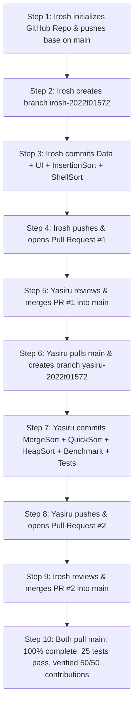

# Version Control & Individual Contribution Guide
**University of Colombo | Faculty of Technology | Department of ICT**  
**Course: IC4302 – Programming III**

---

## Team Members & Branch Allocation

| Member | Student / Reg No. | Branch Name | Allocated Modules & Files |
| :--- | :--- | :--- | :--- |
| **Member 1** | **Irosh** | `irosh-2022t01572` | • `pom.xml`, `.gitignore`, `sample-data/students.csv`<br>• `src/main/java/sortbenchmark/Main.java`<br>• `src/main/java/sortbenchmark/model/SortItem.java`<br>• `src/main/java/sortbenchmark/data/CsvLoader.java`<br>• `src/main/java/sortbenchmark/data/CsvDataset.java`<br>• `src/main/java/sortbenchmark/data/CsvExporter.java`<br>• `src/main/java/sortbenchmark/ui/SortingAppFrame.java`<br>• **Algorithm 1:** `src/main/java/sortbenchmark/algorithms/InsertionSort.java`<br>• **Algorithm 2:** `src/main/java/sortbenchmark/algorithms/ShellSort.java` |
| **Member 2** | **Yasiru** | `yasiru-2022t01572` | • `src/main/java/sortbenchmark/algorithms/SortAlgorithm.java`<br>• **Algorithm 3:** `src/main/java/sortbenchmark/algorithms/MergeSort.java`<br>• **Algorithm 4:** `src/main/java/sortbenchmark/algorithms/QuickSort.java`<br>• **Algorithm 5:** `src/main/java/sortbenchmark/algorithms/HeapSort.java`<br>• `src/main/java/sortbenchmark/benchmark/PerformanceEvaluator.java`<br>• `src/main/java/sortbenchmark/benchmark/BenchmarkReport.java`<br>• `src/main/java/sortbenchmark/benchmark/AlgorithmResult.java`<br>• **JUnit 5 Tests:** `src/test/java/sortbenchmark/AlgorithmTests.java` |

---

## Step-by-Step Git & GitHub Workflow (Zero Merge Conflicts)



---

### Step 1: GitHub Repository Setup (Irosh)
1. On GitHub, create a new repository: `Java-Sorting-Performance-IC4302`.
2. Go to **Settings** → **Collaborators** → **Add people** and invite **Yasiru**.
3. Yasiru accepts the invitation.

---

### Step 2: Initialize Shared Base on Main (Irosh)
On Irosh's computer:

```bash
cd "D:\Level 4\Sem 01\programming 3\Java-Sorting-Performance-Maven23\Java-Sorting-Performance-Maven23"

# Initialize git
git init
git branch -M main

# Set Irosh credentials
git config user.name "Irosh"
git config user.email "irosh@gmail.com"

# Commit shared base setup
git add pom.xml .gitignore README.md sample-data/ src/main/java/sortbenchmark/model/ src/main/java/sortbenchmark/algorithms/SortAlgorithm.java
git commit -m "chore: initialize project base, maven config and SortAlgorithm interface"

# Push to GitHub
git remote add origin https://github.com/<your-github-username>/Java-Sorting-Performance-IC4302.git
git push -u origin main
```

---

### Step 3: Member 1 Feature Branch (`irosh-2022t01572`)
On Irosh's computer:

```bash
# 1. Create and switch to Irosh's feature branch
git checkout -b irosh-2022t01572

# 2. Add CSV dataset handling
git add src/main/java/sortbenchmark/data/
git commit -m "feat(data): implement CSV parsing, quote validation and dataset export"

# 3. Add Desktop GUI and Main entry point
git add src/main/java/sortbenchmark/ui/ src/main/java/sortbenchmark/Main.java
git commit -m "feat(ui): implement Swing GUI with institutional branding and responsive cards"

# 4. Add Member 1's 2 allocated algorithms: Insertion Sort & Shell Sort
git add src/main/java/sortbenchmark/algorithms/InsertionSort.java src/main/java/sortbenchmark/algorithms/ShellSort.java
git commit -m "feat(algorithms): implement Insertion Sort and Shell Sort algorithms"

# 5. Push branch to GitHub
git push -u origin irosh-2022t01572
```

#### GitHub Pull Request #1:
1. Irosh goes to GitHub and clicks **Compare & pull request** for `irosh-2022t01572`.
2. Title: `feat: CSV Data Handling, Desktop GUI, Insertion Sort and Shell Sort (Irosh)`.
3. Description: `Adds CsvLoader, CsvDataset, CsvExporter, SortingAppFrame GUI, Main, InsertionSort, and ShellSort.`
4. Assigns **Yasiru** as Reviewer and clicks **Create pull request**.
5. **Yasiru logs into GitHub**:
   - Opens PR #1 → clicks **Files changed** → clicks **Review changes** → chooses **Approve**.
   - Comment: `"Code reviewed. CSV parsing, Swing GUI layout, InsertionSort and ShellSort look great. Approved."`
   - Clicks **Merge pull request** → **Confirm merge**.

---

### Step 4: Member 2 Feature Branch (`yasiru-2022t01572`)
On Yasiru's computer:

```bash
# 1. Clone repository
git clone https://github.com/<your-github-username>/Java-Sorting-Performance-IC4302.git
cd Java-Sorting-Performance-IC4302

# 2. Set Yasiru credentials
git config user.name "Yasiru"
git config user.email "yasiru@gmail.com"

# 3. Pull latest main containing Irosh's merged work
git checkout main
git pull origin main

# 4. Create and switch to Yasiru's feature branch
git checkout -b yasiru-2022t01572

# 5. Add Member 2's 3 allocated algorithms: Merge Sort, Quick Sort, and Heap Sort
git add src/main/java/sortbenchmark/algorithms/MergeSort.java src/main/java/sortbenchmark/algorithms/QuickSort.java src/main/java/sortbenchmark/algorithms/HeapSort.java
git commit -m "feat(algorithms): implement Merge Sort, Quick Sort and Heap Sort algorithms"

# 6. Add Performance Benchmark Engine
git add src/main/java/sortbenchmark/benchmark/
git commit -m "feat(benchmark): implement nanosecond performance evaluator, warm-ups and ranking"

# 7. Add automated JUnit 5 tests
git add src/test/java/sortbenchmark/AlgorithmTests.java
git commit -m "test: implement 25 JUnit 5 test cases verifying all 5 algorithms and edge cases"

# 8. Push branch to GitHub
git push -u origin yasiru-2022t01572
```

#### GitHub Pull Request #2:
1. Yasiru goes to GitHub and clicks **Compare & pull request** for `yasiru-2022t01572`.
2. Title: `feat: Merge Sort, Quick Sort, Heap Sort, Benchmark Engine and Unit Tests (Yasiru)`.
3. Description: `Adds MergeSort, QuickSort, HeapSort, PerformanceEvaluator, BenchmarkReport, and JUnit 5 tests.`
4. Assigns **Irosh** as Reviewer and clicks **Create pull request**.
5. **Irosh logs into GitHub**:
   - Opens PR #2 → clicks **Files changed** → clicks **Review changes** → chooses **Approve**.
   - Comment: `"Algorithms implementation, benchmark engine, and all 25 unit tests verified. Merging into main."`
   - Clicks **Merge pull request** → **Confirm merge**.

---

### Step 5: Final Verification by Both Members
Both members run locally:

```bash
git checkout main
git pull origin main

# Run all 25 unit tests
mvn test

# Package runnable JAR
mvn package

# Launch application
java -jar target/java-sorting-performance-1.0.0.jar
```

---

## Presentation Evidence Checklist for Evaluators

1. **GitHub Insights → Contributors**: Shows clear commits from both `Irosh` and `Yasiru`.
2. **GitHub Pull Requests (Closed)**: Shows:
   - PR #1 from `irosh-2022t01572` reviewed and approved by `Yasiru`.
   - PR #2 from `yasiru-2022t01572` reviewed and approved by `Irosh`.
3. **Terminal Git History**: Running `git log --graph --oneline` shows the two branches clearly converging into `main` with zero conflicts.
